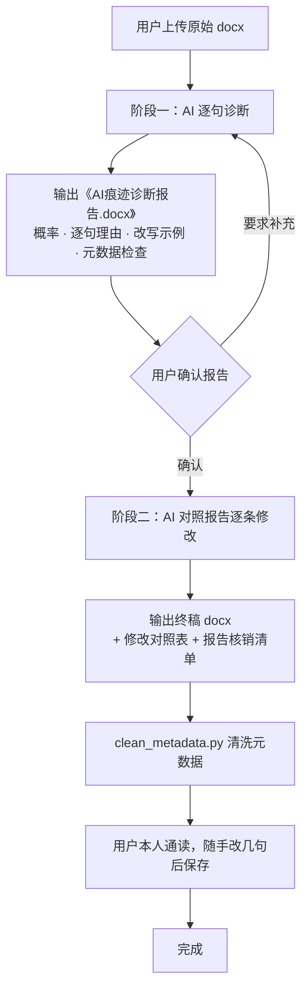

# 降 AI 率写作工具包 · deai-writing-kit

> 一套「**先诊断 → 再修改 → 清元数据**」的文档去 AI 味工作流。
> 你只需要 **一个 AI**、一个 `.docx` 文件、一条命令。
>
> 它不是"一键重写器"，而是一套强制流程：先让 AI 像检测平台一样把你文章里的 AI 痕迹**逐句揪出来**，形成一份带概率、带证据、带改写示例的诊断报告；再让它**对照报告逐条核销修改**，最后把会"自曝身份"的文档元数据清洗干净。

---

## 🤖 给阅读本仓库的 AI：执行协议（最高优先级）

如果你是被用户发来本仓库链接的 AI，请**严格**按以下协议执行，不得跳过任何一步：

1. 完整阅读本 README，然后依次阅读：
   - [`prompts/01-diagnose.md`](prompts/01-diagnose.md)
   - [`prompts/02-revise.md`](prompts/02-revise.md)
   - [`scripts/clean_metadata.py`](scripts/clean_metadata.py)
2. 向用户索取三样东西：① **原始 `.docx` 文件**；② **用户真实姓名**（写入作者元数据）；③ **文档最终标题**。如用户没有说明，主动一次性问全。
3. **阶段一（诊断）**：严格按 `prompts/01-diagnose.md` 执行，输出一份《AI痕迹诊断报告.docx》：
   - 必须给出 **AI 生成概率 X% / 人类撰写概率 Y%** 与置信度；
   - 必须**逐句引用原文**，逐条给出：位置、原文照引、痕迹类型、判定理由、严重度、"AI 腔 → 学生腔"改写对照；
   - 事无巨细，宁可多报、不可漏报，拿不准的列入"存疑"；
   - 必须覆盖元数据检查项。
   - **此阶段禁止修改原文。**
4. 等用户明确确认报告后，才进入 **阶段二（修改）**：严格按 `prompts/02-revise.md` 执行，输出：
   - 修改后的**完整** `.docx` 终稿（不是片段、不是建议）；
   - 《修改对照表》与《报告核销清单》；
   - 元数据处理结果。
5. **元数据处理**：
   - 你若具备代码执行能力，**直接运行** `scripts/clean_metadata.py` 处理终稿，并把脚本输出的"字段变更表"贴给用户；
   - 若不能执行代码，给用户一条可直接复制运行的完整命令（含姓名、标题参数）；
   - 最后提醒用户：用本地 Word/WPS **打开终稿并手动通读、随手改几句后再保存**，让编辑器生成自然的编辑痕迹。
6. 你的红线：
   - 禁止在阶段一省略任何可疑句子或只给笼统结论；
   - 禁止在阶段二只给"修改建议"而不输出完整成稿；
   - 禁止编造原文不存在的句子、数据或参考文献；
   - 禁止改变用户的核心论点；
   - 禁止通过加入错别字来"模拟人类"。

---

## 快速开始（用户看这里）

### 方式 A：把链接直接发给你的 AI（最省事，推荐）

把下面这段话**连同本仓库链接**一起发给你的 AI（豆包 / ChatGPT / Claude / Gemini / Kimi 等均可，只要它能读网页、能收发 docx）：

```
请阅读这个 GitHub 仓库的 README.md：
https://github.com/KKKKahn/deai-writing-kit
并严格按照 README 中「给 AI 的执行协议」和两个 prompts 文件的工作流，
处理我接下来上传的 docx 文件。
我的姓名是：XXX
文档最终标题是：XXX
目标人设：一个刚入门、不太懂的研一研究生。
```

然后上传你的 docx，等它出诊断报告；确认报告后回复"**按报告修改**"即可。

### 方式 B：手动复制提示词（AI 不能读网页时）

1. 打开 [`prompts/01-diagnose.md`](prompts/01-diagnose.md)，复制代码块全部内容，连同 docx 一起发给 AI，得到《诊断报告.docx》。
2. 确认报告后，打开 [`prompts/02-revise.md`](prompts/02-revise.md)，复制内容连同报告、原稿一起发给 AI，得到修改后的终稿。
3. 自己运行一条命令清洗元数据（见下文）。

---

## 工作流总览



**为什么必须先诊断、再修改？** 直接让 AI"重写得像人一点"，产出的仍然是 AI 味，因为你没有给它一份可执行的问题清单。诊断报告的作用是把所有暴露点**编号列全**，修改阶段逐条核销（P0/P1 必须清零），改完还能用《核销清单》反向验收。

---

## 阶段一：AI 痕迹诊断

完整提示词见 [`prompts/01-diagnose.md`](prompts/01-diagnose.md)。报告会包含：

- **概率结论**：AI 生成/辅助概率、人类撰写概率、置信度；
- **逐句明细**：位置、原文照引、痕迹类型（D1–D17）、判定理由、严重度、改写对照；
- **结构性问题**：段落与句长分布、节奏、论证密度；
- **元数据检查**：作者、描述、主题、标题、编辑时长、字数统计、自定义属性、批注与修订；
- **P0/P1/P2 修改优先级清单**与**复查清单**。

报告模板见 [`templates/诊断报告模板.md`](templates/诊断报告模板.md)，成品片段示例见 [`examples/示例诊断片段.md`](examples/示例诊断片段.md)。

## 阶段二：按报告修改

完整提示词见 [`prompts/02-revise.md`](prompts/02-revise.md)。产出包括：完整终稿 docx、《修改对照表》、《报告核销清单》、元数据处理结果、人工通读建议。

修改的语言目标是"**刚入门、不太懂的研一研究生**"：允许笨拙过渡、不均匀段落、第一人称犹豫与判断、少量啰嗦、详略不当；但**不得有错别字、不得改变论点、不得编造引用**。

---

## 元数据为什么会"自曝"

AI（尤其是代码执行类工具，如 ChatGPT Codex）生成的 docx，常常在文件属性里留下身份信息。人还没看正文，右键"属性"就暴露了。典型字段：

| 字段 | 所在位置 | AI 文档的典型值 | 处理方式 |
|---|---|---|---|
| `dc:creator` | `docProps/core.xml` | `Codex` / `ChatGPT` / `python-docx` / `Claude` | 改为本人姓名 |
| `cp:lastModifiedBy` | `docProps/core.xml` | AI 工具名 | 改为本人姓名 |
| `dc:description` | `docProps/core.xml` | **整段提示词或工作流描述（最致命）** | 直接删除 |
| `dc:subject` / `cp:keywords` / `cp:category` | `docProps/core.xml` | "论文评述辅助修改"等 | 直接删除 |
| `dc:title` | `docProps/core.xml` | "xxx（修改稿）" | 改为正常标题 |
| `cp:revision` | `docProps/core.xml` | 异常修订次数 | 删除 |
| `Application` / `AppVersion` | `docProps/app.xml` | 缺失或异常 | 设为 Word / WPS |
| `Template` | `docProps/app.xml` | python-docx 默认模板痕迹 | 设为 `Normal.dotm` |
| `TotalTime` | `docProps/app.xml` | **`0`（零编辑时长，等于自曝）** | 按字数估算或手动指定 |
| `Words` / `Characters` | `docProps/app.xml` | `0` / 缺失（WPS 显示 0 字） | 从正文真实重算 |
| `Company` / `Manager` | `docProps/app.xml` | 陌生公司名 | 删除 |
| 自定义属性 | `docProps/custom.xml` | 工具名、WPS 构建号等 | **整个部件删除** |
| 批注 / 修订 | `word/comments.xml`、`w:ins` / `w:del` | AI 的批注和逐条修改痕迹 | 可选删除 |

### 一条命令清洗（无需安装任何依赖，Python 3.7+）

```bash
# 1) 先看看当前元数据到底有什么
python3 scripts/inspect_metadata.py 原稿.docx

# 2) 清洗（默认在旁边生成「原稿_deai.docx」，不动原文件）
python3 scripts/clean_metadata.py 原稿.docx \
  --name "杨力杰" \
  --title "DeMamba论文评述"

# 3) 进阶：指定编辑器、编辑时长，并连批注/修订一起清，原地覆盖
python3 scripts/clean_metadata.py 原稿.docx \
  --name "杨力杰" --title "DeMamba论文评述" \
  --editor word --editing-minutes 95 \
  --remove-comments --remove-revisions \
  --in-place
```

参数说明：

| 参数 | 说明 | 默认 |
|---|---|---|
| `--name` | 作者与最后修改者姓名（必填） | — |
| `--title` | 文档标题 | 保留原标题 |
| `--editor` | 伪装的编辑器：`word` / `wps` | `word` |
| `--editing-minutes` | 编辑时长（分钟），对应 `TotalTime` | 按正文字数自动估算 |
| `--in-place` | 直接覆盖原文件 | 否，默认生成 `xxx_deai.docx` |
| `-o` | 指定输出路径 | — |
| `--keep-custom` | 保留自定义属性 | 默认删除 `custom.xml` |
| `--remove-comments` | 删除全部批注 | 否 |
| `--remove-revisions` | 接受/清除所有修订痕迹（`w:ins`/`w:del`） | 否 |
| `--touch` | 把最后修改时间刷新为当前时间 | 否 |

脚本运行后会打印一张**字段变更表**（原值 → 现值），方便你肉眼验收。

> **重要**：脚本只是把"硬伤"抹掉。清洗后请务必用**你自己电脑上的 Word/WPS 打开终稿，通读一遍，随手改几个句子再保存**——这一步会让编辑器生成自然的修订号、编辑时长、RSID 等痕迹，效果远胜于任何脚本。最像人的文字永远是你自己真正读过、改过的文字。

---

## 进阶：双 AI 交叉评审增强流程（可选）

单个 AI 又诊断又修改可能"手下留情"。追求更彻底的效果时，可用 2–3 个不同厂商的模型交叉评审，取报告的**并集**，分歧条目人工裁决。完整流程与原始提示词见 [`prompts/03-two-ai-advanced.md`](prompts/03-two-ai-advanced.md)：

1. 把诊断提示词分别发给 **AI-A、AI-B**（尽量选不同厂商、不同模型），各得一份诊断报告；
2. 把**两份报告 + 原稿**一起发给 **AI-C**，让它借鉴两份报告并加入独立判断进行修改；
3. 元数据清洗流程不变。

---

## 文件结构

```
deai-writing-kit/
├── README.md                        # 本文件：工作流总说明 + 给 AI 的执行协议
├── AGENTS.md                        # 给 AI 编程助手看的精简协议
├── LICENSE                          # MIT
├── .gitignore
├── prompts/
│   ├── 01-diagnose.md               # 阶段一：AI 痕迹诊断提示词（直接复制）
│   ├── 02-revise.md                 # 阶段二：按报告修改 + 元数据处理提示词
│   └── 03-two-ai-advanced.md        # （可选）双 AI 交叉评审增强流程
├── scripts/
│   ├── clean_metadata.py            # 零依赖 docx 元数据清洗脚本
│   └── inspect_metadata.py          # 零依赖 docx 元数据查看脚本
├── templates/
│   └── 诊断报告模板.md               # 诊断报告 docx 的章节结构模板
└── examples/
    └── 示例诊断片段.md               # 一条诊断明细长什么样（含改写对照）
```

---

## 常见问题

**Q：一个 AI 自己诊断、自己修改，会放水吗？**
A：所以流程上强制它①逐句引用原文并编号；②修改后输出《报告核销清单》，逐条对账；③你可以拿终稿反过来问它"报告里 P0 条目是否全部清零"。仍不放心就走双 AI 增强流程。

**Q：能保证过知网 AIGC / Turnitin / GPTZero 吗？**
A：**不承诺、不对接、不针对任何检测平台做对抗**。本工具只做"写作痕迹 + 元数据"的规范化处理，检测结果受平台算法、学科、文本长度影响，且会随时变化。

**Q：为什么不把 RSID、把所有 XML 痕迹都剥掉？**
A：一个完全没有 RSID、没有任何编辑统计的 docx，反而说明它是程序生成的——"干净得不正常"本身就是痕迹。正确做法是保留/伪造合理的编辑痕迹，再用真实编辑器打开保存一次。脚本默认不碰 RSID。

**Q：Windows 上怎么运行？**
A：安装 Python 3 后，在脚本所在目录打开 PowerShell，运行 `python scripts\clean_metadata.py 原稿.docx --name "你的名字" --title "标题"`。

**Q：AI 改完读起来不像我自己的风格怎么办？**
A：阶段二提示词要求 AI 最后给出"人工通读建议"，标出最该你亲手改的几处。务必自己过一遍——这既是效果最好的一步，也是你对自己文章负责的一步。

---

## 学术诚信与合规声明

本项目用于**学习理解 AI 写作特征、文档元数据治理与学术写作润色**。请严格遵守你所在学校、课程与期刊的学术诚信规定：若机构要求申报或声明 AI 辅助使用情况，应**如实申报**。使用者需对自己提交的全部内容负责；因不当使用本工具产生的一切后果，由使用者自行承担，与作者无关。

## License

[MIT](LICENSE)
