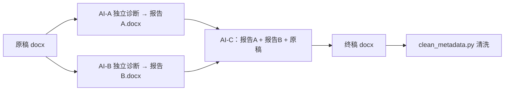

# （可选）双 AI 交叉评审增强流程

> 单个 AI"又当运动员又当裁判"可能手下留情。本流程用 2 个不同 AI 各自独立诊断，
> 再交给第 3 个 AI（也可以是前两个中的一个）合并修改。
> 三份提示词均为实测可用的原始版本，可直接复制。

## 流程图



要点：AI-A、AI-B 尽量选**不同厂商 / 不同模型**（例如一个国产模型、一个海外模型），
两份报告取**并集**；两份报告结论冲突的条目，不要二选一，列入"存疑"由你人工裁决。

---

## 第一步：诊断提示词（原样分别发给 AI-A 和 AI-B）

下面是本流程最初使用的原始提示词，一字未改，可直接使用；如希望报告更规范，
建议改用 [`01-diagnose.md`](01-diagnose.md) 的加强版分别发给两个 AI：

```
判断一下这篇文章是 AI 写的概率是多少，人写的是多少，再写一个为什么的报告
docx，非常详细地写出文章中每个地方导致你这样判断，事无巨细。
```

要求两个 AI 都输出 docx 报告，分别保存为《诊断报告A.docx》《诊断报告B.docx》。

---

## 第二步：合并修改提示词（发给 AI-C，附两份报告 + 原稿）

```
我需要撰写一个文本，目前两个 AI 评审出来我的报告出现了一些 AI 的痕迹，
请你借鉴他们报告的内容并且加上你的独立思辨，帮我修改我的评述内容，
使它更像一个普通研一研究生、刚刚入门、不太懂的研究生写的。
```

建议在原始提示词后补充以下要求（原提示词较短，补上后产出更稳定）：

```
补充要求：
1. 两份报告中提到的问题取并集，逐条核销；两份报告意见冲突的地方列出来，
   给出你自己的判断和理由；
2. 直接输出修改后的完整 docx 全文，不要只给修改建议；
3. 保留我的核心观点和引用，不许编造数据或文献，不许出现错别字；
4. 随文附《修改对照表》和《报告核销清单》；
5. 最后提醒我运行 scripts/clean_metadata.py 清洗元数据。
```

---

## 第三步：元数据清洗

与单 AI 流程完全相同：

```bash
python3 scripts/clean_metadata.py 终稿.docx \
  --name "你的姓名" --title "文档标题" \
  --remove-comments --remove-revisions
```

## 适用建议

- 短文（2000 字以内）：单 AI 流程通常足够；
- 长论文、课程报告、评述类文章：推荐双 AI 流程，诊断覆盖率明显更高；
- 无论用哪种流程，**最后一步必须是你本人通读并亲手改几句**——这是任何 AI 流程都替代不了的。
